# Enterprise IT Support & Network Troubleshooting Lab

## Project Overview

This project demonstrates practical IT support and networking skills through a simulated enterprise network built in Cisco Packet Tracer, alongside Windows and Ubuntu network troubleshooting exercises and DNS packet analysis using Wireshark.

The lab focuses on network segmentation, IP configuration, connectivity testing, fault identification, corrective actions, and technical documentation.

## Objectives

- Build a small enterprise network with separate departmental VLANs.
- Configure inter-VLAN routing using router subinterfaces.
- Test network connectivity and identify configuration errors.
- Practice Windows and Linux network diagnostic commands.
- Inspect DNS queries and responses using Wireshark.
- Document troubleshooting procedures and incident resolution.

## Lab Environment

| Component | Details |
|---|---|
| Network simulator | Cisco Packet Tracer |
| Network devices | 1 router, 1 switch, 3 PCs |
| Departments | IT, HR, Finance |
| Host operating system | Windows 11 |
| Linux environment | Ubuntu Linux running in VirtualBox |
| Packet analysis tool | Wireshark |
| Diagnostic tools | Ping, Traceroute, NSLookup, IPConfig, and Linux networking utilities |

## Project Files

- [Cisco Packet Tracer Lab](Enterprise_IT_Support_Lab.pkt)
- [Incident Reports](incident_reports.txt)
- [Network Inventory](network_inventory.txt)
- [Troubleshooting Checklist](troubleshooting_checklist.txt)
- [Ubuntu Network Troubleshooting Report](ubuntu_network_troubleshooting.txt)
- [Wireshark DNS Troubleshooting Report](dns_troubleshooting_report.txt)

## Project Screenshots

### 1. Network Topology

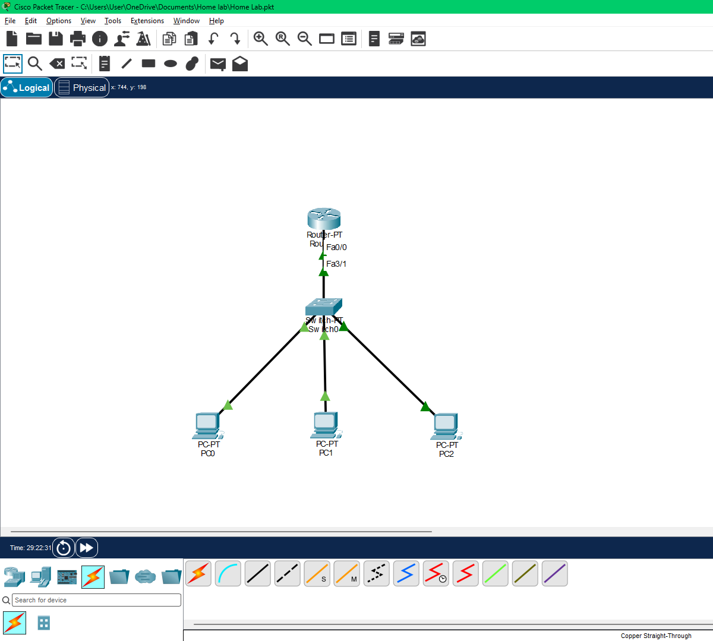

### 2. VLAN Configuration

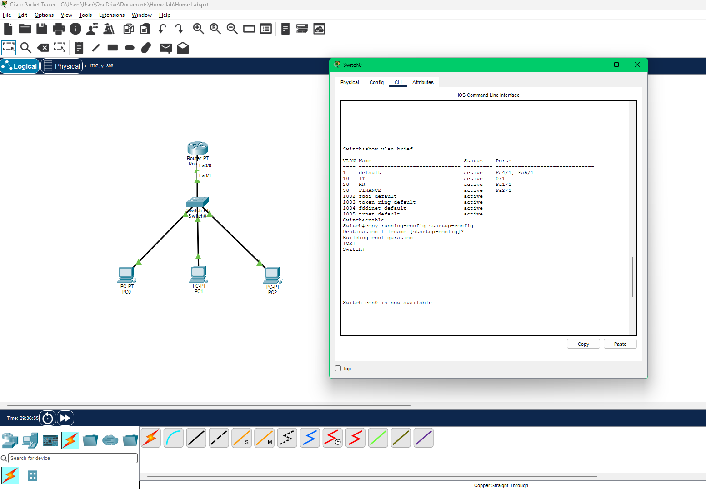

### 3. Router Interfaces

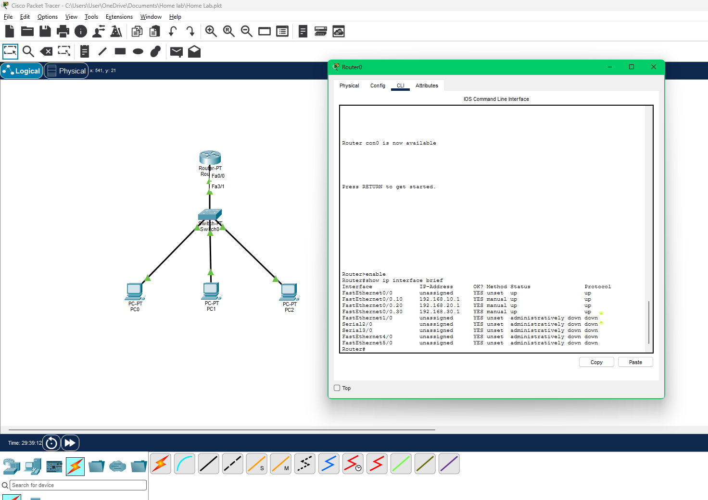

### 4. Successful Connectivity Test

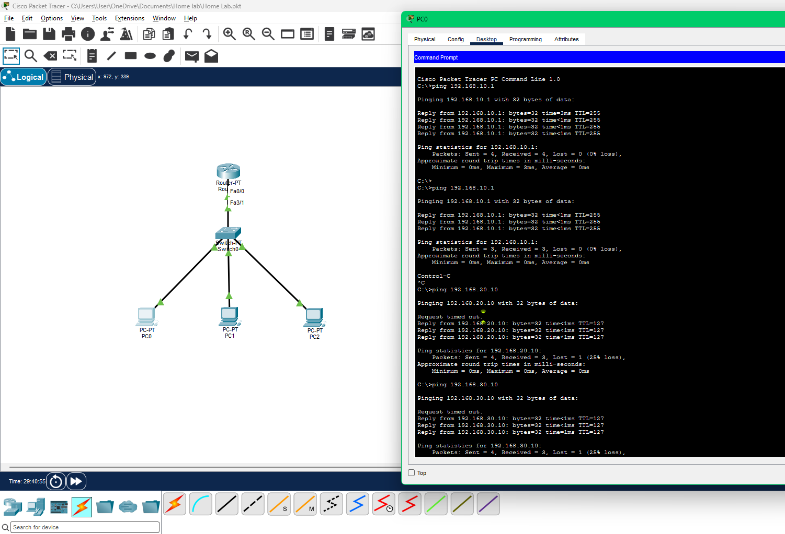

### 5. Simulated Network Failure

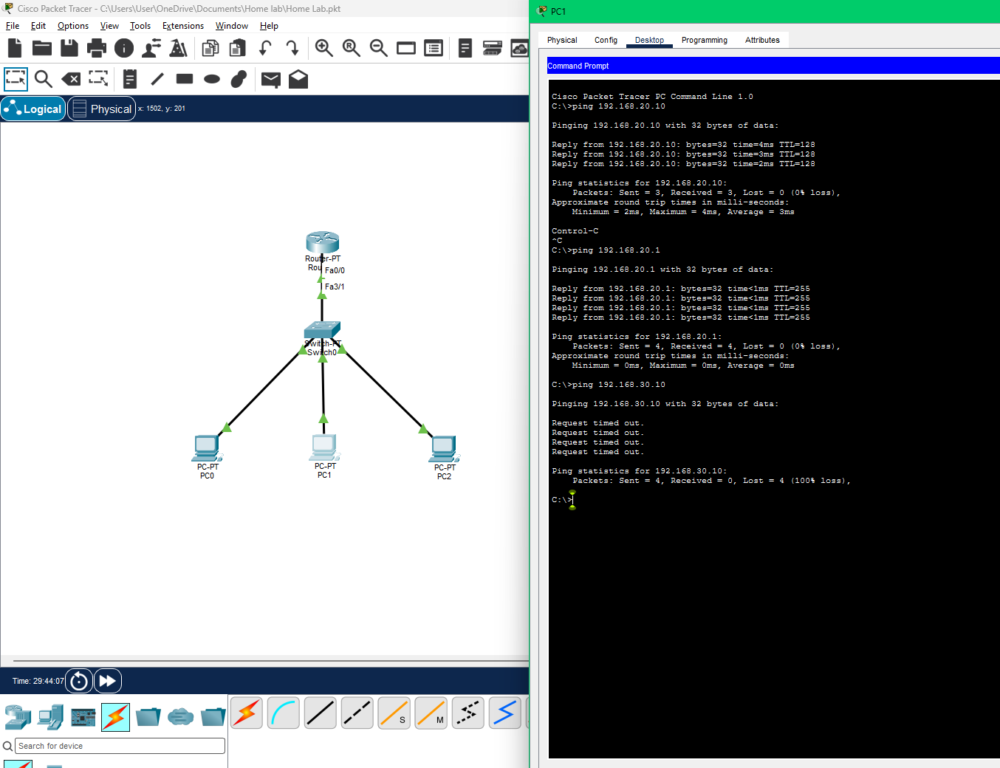

### 6. Troubleshooting Resolution

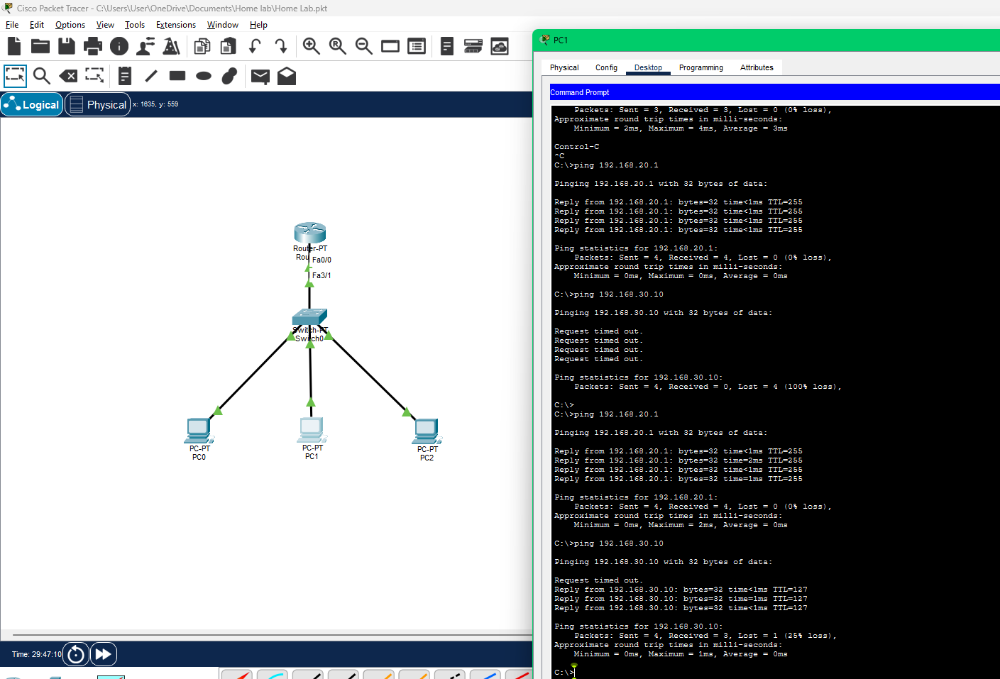

### 7. Windows IP Configuration

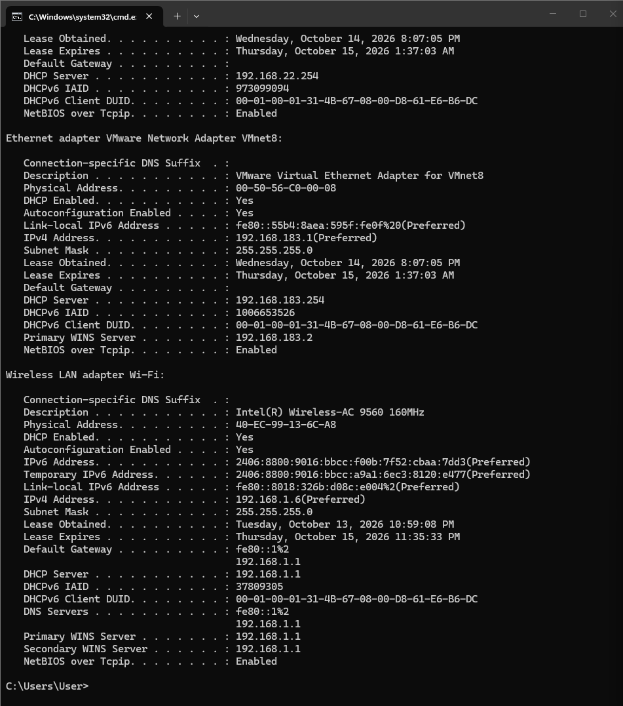

### 8. Windows Connectivity Tests

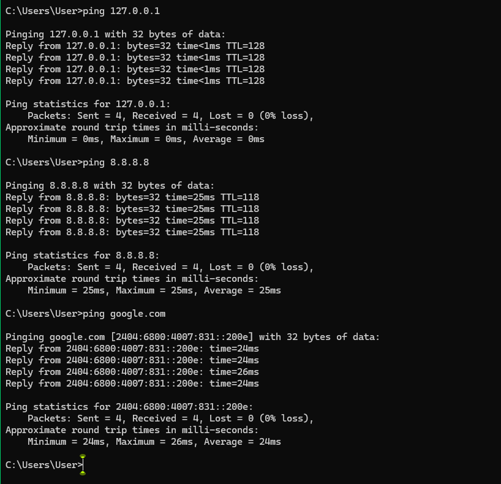

### 9. DNS Lookup — Google

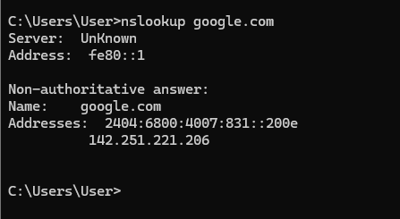

### 10. DNS Lookup — Microsoft

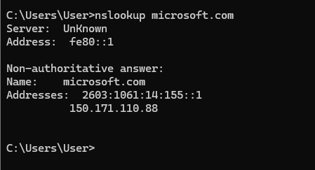

### 11. Traceroute — Google

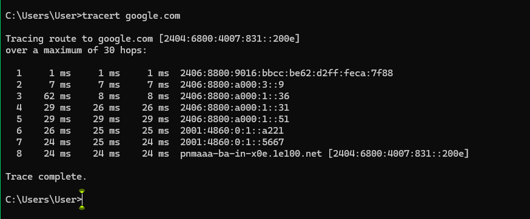

## Network Design

The simulated network contains three departmental VLANs.

| Department | VLAN ID | Network | PC IP Address | Default Gateway |
|---|---:|---|---|---|
| IT | 10 | 192.168.10.0/24 | 192.168.10.10 | 192.168.10.1 |
| HR | 20 | 192.168.20.0/24 | 192.168.20.10 | 192.168.20.1 |
| Finance | 30 | 192.168.30.0/24 | 192.168.30.10 | 192.168.30.1 |

### Network Configuration

- Created VLANs for departmental network segmentation.
- Assigned switch ports to the appropriate VLANs.
- Configured an 802.1Q trunk between the switch and router.
- Configured router subinterfaces for inter-VLAN routing.
- Configured IP addresses, subnet masks, and default gateways on client PCs.
- Saved device configurations.
- Tested connectivity between devices on different VLANs.

## Troubleshooting Scenario: Incorrect Default Gateway

**Problem:** A simulated connectivity failure was introduced by configuring the HR PC with an incorrect default gateway.

**Investigation:** Connectivity tests were performed to investigate the failure and identify the configuration issue.

**Corrective action:** The incorrect gateway was replaced with `192.168.20.1`.

**Verification:** Connectivity was tested again after the correction.

This exercise demonstrates a structured troubleshooting approach: identify the issue, investigate the configuration, apply a targeted fix, and verify the result.

## Windows Network Troubleshooting

The following Windows Command Prompt utilities were used during the lab.

| Command | Purpose |
|---|---|
| `ipconfig /all` | Inspect IP configuration, gateways, and DNS settings |
| `ping 127.0.0.1` | Test the local TCP/IP stack |
| `ping 8.8.8.8` | Test connectivity to an external IP address |
| `ping google.com` | Test connectivity using a hostname |
| `nslookup google.com` | Check DNS name resolution |
| `nslookup microsoft.com` | Check DNS name resolution for another hostname |
| `tracert google.com` | Examine the network path to a destination |

These commands provide a foundation for diagnosing IP configuration, connectivity, DNS resolution, and routing-path issues.

## Ubuntu Linux Troubleshooting

Ubuntu was used to practise basic Linux system and network diagnostics.

Commands executed included:

| Command | Purpose |
|---|---|
| `ip addr` | Inspect network interfaces and IP addresses |
| `ip route` | Inspect the routing table |
| `ping -c 4 8.8.8.8` | Test external IP connectivity |
| `getent hosts google.com` | Check hostname resolution |
| `df -h` | Inspect filesystem disk usage |
| `free -h` | Inspect memory usage |
| `hostname` | Display the system hostname |
| `lsb_release -a` | Display Linux distribution information |

These exercises provide practice with Linux command-line administration and basic network troubleshooting.

## Wireshark DNS Analysis

Wireshark was used to capture and inspect DNS traffic generated by hostname lookup commands.

### Procedure

1. Started a packet capture on the active network interface.
2. Executed `nslookup example.com` and `nslookup microsoft.com`.
3. Applied the `dns` display filter.
4. Inspected DNS query and response packets.
5. Examined the requested domain names and DNS response details.

### Skills Practised

- Packet capture and inspection.
- DNS query and response analysis.
- Wireshark display filtering.
- Basic network troubleshooting.

See [Wireshark DNS Troubleshooting Report](dns_troubleshooting_report.txt) for the exercise documentation.

## Documentation

The repository includes the following documentation:

- [Incident Reports](incident_reports.txt) — records of troubleshooting exercises and their outcomes.
- [Network Inventory](network_inventory.txt) — network device and addressing information.
- [Troubleshooting Checklist](troubleshooting_checklist.txt) — a repeatable troubleshooting procedure.
- [Ubuntu Network Troubleshooting](ubuntu_network_troubleshooting.txt) — Linux diagnostic exercises.
- [DNS Troubleshooting Report](dns_troubleshooting_report.txt) — Wireshark DNS analysis exercise.

## Skills Demonstrated

- Basic network configuration and troubleshooting.
- VLAN creation and network segmentation.
- Inter-VLAN routing.
- IP addressing and subnetting fundamentals.
- Default gateway troubleshooting.
- Windows network diagnostics.
- Linux command-line fundamentals.
- DNS resolution testing.
- Basic packet analysis using Wireshark.
- Traceroute analysis.
- Technical documentation and incident reporting.
- Structured problem-solving.

## Project Scope

This is a self-directed learning lab created for practical skill development and portfolio demonstration. It uses a simulated network rather than a production enterprise environment.

The exercises demonstrate foundational IT support and networking concepts. They do not represent experience administering a live enterprise network.

## Author

**Sourav Raveendran**

Aspiring IT Support / Desktop Support / Network Support Professional

GitHub: [S0uravRaveendran](https://github.com/S0uravRaveendran)
